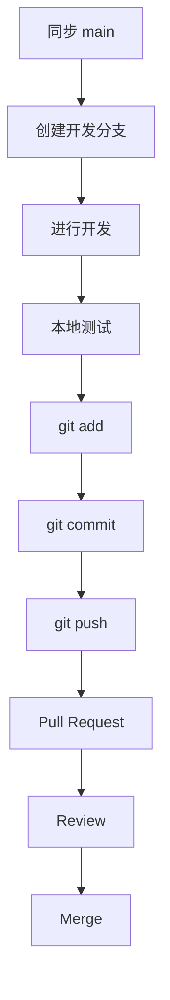

<!--
作者 / Author: XCrane
-->

<div align="center">

<a href="https://github.com/CCU-Robotics-Association">
  
</a>

# CCU Robotics Association

### GitHub 提交与协作指南 · Contribution Guide

CCU 机器人协会 · 2026 —— Future

[](https://github.com/CCU-Robotics-Association)


[**官网(Website) »**](https://ccu-robotics-association.github.io/) | [**GitHub 主页 »**](https://github.com/CCU-Robotics-Association) | [**协会主页(Community) »**](https://github.com/CCU-Robotics-Association/.github/blob/main/profile/README.md)

> **一  同  奋  进  前  行  ，  共  就  非  凡  之  事**

</div>

---

> [!NOTE]
> 本文档用于规范 **CCU 机器人协会 GitHub Organization** 内的代码提交、分支管理、Commit、Pull Request 及 Issue 使用方式

##  Navigation | 导航

<table>
<tr>
<td width="50%" valign="top">


### Workflow | 协作流程

- [基本原则](#principles)
- [Git 配置](#git-setup)
- [Clone 项目](#clone)
- [分支规范](#branches)
- [开发流程](#workflow)
- [文件与目录](#structure)
- [大文件处理](#large-files)
- [冲突处理](#conflicts)

</td>
<td width="50%" valign="top">


### Standards | 提交规范

- [Commit 规范](#commits)
- [Push 规范](#push)
- [Pull Request](#pull-requests)
- [Issue](#issues)
- [README 与文档](#documentation)
- [禁止提交内容](#sensitive-data)
- [常用 Git 命令](#commands)
- [检查列表](#checklist)

</td>
</tr>
</table>

<a name="principles"></a>

##  Principles | 基本原则

协会 GitHub 协作项目的代码提交应遵循以下原则：

| 序号 | 原则 |
| :---: | :--- |
| **01** | 未经沟通，不直接修改不属于自己的内容 |
| **02** | 未经沟通，不随意删除其他成员的代码 |
| **03** | 不将未经测试的代码直接提交到主分支 |
| **04** | 每次提交只完成一个相对明确的任务 |
| **05** | Commit 信息应说明本次修改内容 |
| **06** | 提交前检查代码能否正常运行 |
| **07** | 重要修改优先通过 Pull Request 合并 |

> [!IMPORTANT]
> `main` 分支应确保 **稳定、完整、可运行、非完全 AI 代码**
>
> 若不确定修改是否应该直接提交，请先创建独立分支，再提交 ***Pull Request***

<a name="git-setup"></a>

##  Git Setup | Git 配置

首次使用 ***Git*** 时，配置用户名与邮箱：

```bash
git config --global user.name "你的GitHub用户名"
git config --global user.email "你的GitHub邮箱"
```

查看当前配置：

```bash
git config --global --list
```

<a name="clone"></a>

##  Clone | 获取项目

打开目标 ***GitHub Repository***，点击 ***Code***，复制仓库地址，再克隆到本地：

```bash
git clone https://github.com/CCU-Robotics-Association/项目名称.git
cd 项目名称
```

<a name="branches"></a>

##  Branches | 分支规范

### Main Branch | 主分支

项目默认主分支为 `main`，应保持 **稳定、完整、可运行、非完全 AI 代码**

> [!WARNING]
> 请勿直接在 `main` 上进行较大的功能开发(除 *Owner*)

### Development Branch | 开发分支

进行功能开发、Bug 修复或文档修改时，应建立新的分支，命名采用 `类型/内容`：

| 前缀 | 用途 | 示例 |
| :--- | :--- | :--- |
| `feature/` | 新功能开发 | `feature/opencv-camera` |
| `fix/` | Bug 修复 | `fix/image-read-error` |
| `docs/` | 文档修改 | `docs/update-readme` |
| `refactor/` | 代码重构 | `refactor/pid-controller` |
| `test/` | 测试相关 | `test/camera-module` |
| `chore/` | 配置、工程杂项 | `chore/update-config` |

### Create a Branch | 创建分支

切换到主分支并同步最新代码，再创建开发分支：

```bash
git switch main
git pull
git switch -c feature/example
```

查看当前分支：

```bash
git branch
```

<a name="workflow"></a>

##  Workflow | 开发流程



<a name="commits"></a>

##  Commit | 提交记录

Commit 是项目的重要开发记录，应包含有效信息，说明本次修改

### Format | 推荐格式

```text
type: description
```

### Types | 提交类型

| 类型 | 含义 |
| :---: | :--- |
| `feat` | 新功能 |
| `fix` | 修复 Bug |
| `docs` | 文档修改 |
| `style` | 格式调整 |
| `refactor` | 代码重构 |
| `perf` | 性能优化 |
| `test` | 测试 |
| `build` | 构建相关 |
| `ci` | CI 相关 |
| `chore` | 其他修改 |
| `revert` | 回退修改 |

<a name="push"></a>

##  Push | 推送规范

开发分支首次推送时，设置远程跟踪分支：

```bash
git push -u origin branch-name
```

例如：

```bash
git push -u origin feature/opencv-camera
```

后续提交：

```bash
git push
```

### Force Push | 强制推送

除特殊情况外，请避免执行 `git push --force`，尤其禁止对 `main` 执行 Force Push

> [!CAUTION]
> Force Push 可能覆盖远程提交记录，导致代码丢失

<a name="pull-requests"></a>

##  Pull Request | 合并请求

严禁以“开发完成后直接 Push main”的方式代替协作合并流程

推荐流程：**开发分支 → Push → Pull Request → Review → Merge**

### Title | PR 标题

建议与 Commit 保持类似格式：

```text
type: description
```

### Description | PR 描述

Pull Request 至少说明以下内容：

```markdown
- 修改内容
- 修改原因
- 测试情况
```

<a name="issues"></a>

##  Issue | 问题与讨论

Issue 可用于 Bug 报告、功能建议、开发任务、文档问题和项目讨论

<a name="documentation"></a>

##  Documentation | README 与文档

协会项目原则上都应具备 `README.md`，规范参考 [CRA README 编写 Prompt](https://github.com/CCU-Robotics-Association/CRA-Skill-Prompt/blob/main/prompts/readme/README_STYLE_PROMPT.md)

<a name="structure"></a>

##  Structure | 文件与目录

保持清晰的目录结构，例如 Python 项目：

```text
project/
│
├── README.md
├── LICENSE
├── requirements.txt
│
├── src/
│   ├── main.py
│   └── utils.py
│
├── docs/
│   └── images/
│
└── tests/
```

### Naming | 命名要求

禁止使用以下含义不明确的命名：

```text
新建文件夹
新建文件夹2
test2
test3
最终
最终2
```

<a name="sensitive-data"></a>

##  Sensitive Data | 禁止提交内容

> [!CAUTION]
> 以下内容原则上禁止上传 GitHub

### Password | 密码

```python
password = "xxxx"
```

### Token / API Key | 访问凭据

```text
GitHub Token
OpenAI API Key
QQ 机器人Token
云服务Access Key
```

### Private Key | 私钥

```text
id_rsa
*.pem
*.key
```

### Database | 数据库账号

```text
DATABASE_PASSWORD
DATABASE_URL
```

> [!IMPORTANT]
> 敏感配置应通过环境变量、配置文件模板或其他安全方式管理，并将实际配置加入 `.gitignore`

<a name="large-files"></a>

##  Large Files | 大文件处理

大文件可以放在网盘中

<a name="conflicts"></a>

##  Conflicts | 冲突处理

如果 Push 时提示 `rejected`，请勿直接 Force Push，先尝试同步远程修改：

```bash
git pull
```

或者：

```bash
git pull --rebase
```

### Resolve Conflicts | 解决冲突

发生冲突时，可能看到以下标记：

```text
<<<<<<< HEAD
你的代码
=======
其他人的代码
>>>>>>> branch
```

确认最终保留的内容，处理完成后添加修改：

```bash
git add .
```

普通 Merge 情况继续：

```bash
git commit
```

Rebase 情况继续：

```bash
git rebase --continue
```

> [!WARNING]
> 如果无法判断应该保留哪部分内容，请勿随意删除冲突代码

<a name="commands"></a>

##  Git Commands | 常用命令

<details>
<summary><strong>查看状态与提交记录</strong></summary>

查看状态：

```bash
git status
```

查看提交记录：

```bash
git log --oneline
```

</details>

<details>
<summary><strong>查看、创建与切换分支</strong></summary>

查看分支：

```bash
git branch
```

创建分支：

```bash
git switch -c feature/example
```

切换分支：

```bash
git switch main
```

</details>

<details>
<summary><strong>获取最新代码</strong></summary>

```bash
git pull
```

</details>

<details>
<summary><strong>添加修改与提交 Commit</strong></summary>

添加单个文件：

```bash
git add filename
```

添加全部修改：

```bash
git add .
```

提交 Commit：

```bash
git commit -m "feat: 添加新功能"
```

</details>

<details>
<summary><strong>推送与查看远程仓库</strong></summary>

推送提交：

```bash
git push
```

查看远程仓库：

```bash
git remote -v
```

</details>

<a name="checklist"></a>

##  Checklist | 检查列表

- 检查修改范围是否明确，涉及其他成员的内容是否已沟通
- 检查当前分支是否符合开发任务，较大的功能开发是否使用独立分支
- 检查代码是否完成本地测试并能正常运行
- 检查 Commit 信息是否清楚说明修改内容
- 检查提交中是否包含密码、Token、私钥或数据库账号等敏感配置
- 检查冲突内容是否已确认，是否误删其他成员的代码
- 检查重要修改是否通过 Pull Request 提交，并说明修改内容、原因与测试情况

---

<div align="center">

### CCU · ROBOTICS · ASSOCIATION

<sub>GitHub 提交与协作指南 | CRA .github</sub>

[**官网(Website)**](https://ccu-robotics-association.github.io/) · [**GitHub 主页**](https://github.com/CCU-Robotics-Association) · [**协会主页(Community)**](https://github.com/CCU-Robotics-Association/.github/blob/main/profile/README.md)

<sub>CCU Robotics Association</sub>

</div>
